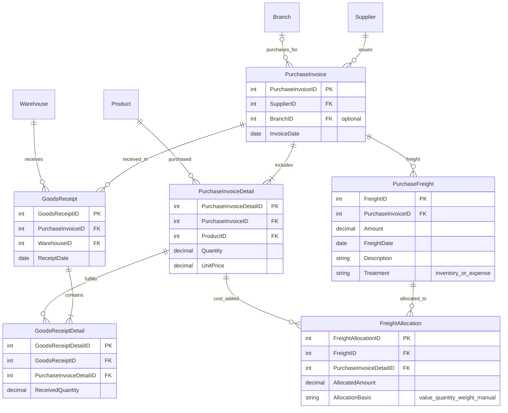

# المشتريات والاستلام والشحن

**ضوابط:** في معالجة INVENTORY يجب أن يساوي مجموع التوزيع تكلفة الشحن، وأن تكون الأسطر ضمن فاتورة الشحن نفسها. في EXPENSE لا توجد أسطر توزيع. راجع [قواعد التنفيذ](../docs/implementation-rules.md).
