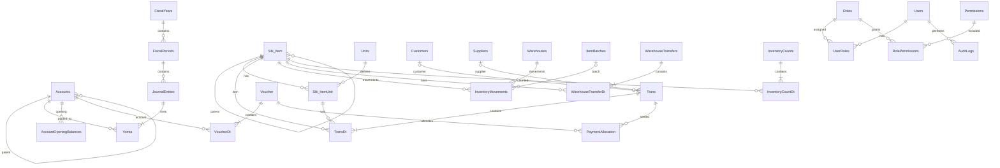

# مخطط النظام المحاسبي المقترح (ERD) — الإصدار 1

> تصميم منطقي مقترح مستند إلى مناقشات المشروع؛ يحتاج مطابقة أسماء الأعمدة والأنواع مع مخططات المهندس صلاح قبل تنفيذ قاعدة SQLite. لا يمثل مخطط قاعدة البيانات المنفذة حاليًا.

## مراحل المشروع
تحليل المتطلبات ← ERD ← قاموس البيانات والمفاتيح ← SQLite ← منطق الأعمال والترحيل ← واجهات Android ← الربط ← المحاكي ← الاختبار ← APK.

## الوحدات والجداول
| الوحدة | الجداول |
|---|---|
| دليل الحسابات | Accounts, AccountOpeningBalances |
| الأصناف والوحدات | Stk_Item, Units, Stk_ItemUnit, ItemBatches |
| الأطراف | Customers, Suppliers |
| الفواتير | Trans, TransDt |
| السندات والتسويات | Voucher, VoucherDt, PaymentAllocation |
| المخزون | Warehouses, InventoryMovements, WarehouseTransfers, WarehouseTransferDt, InventoryCounts, InventoryCountDt, StockAdjustments |
| المحاسبة | FiscalYears, FiscalPeriods, JournalEntries, Yomia, CostCenters, Currencies, ExchangeRates |
| النظام | Users, Roles, Permissions, UserRoles, RolePermissions, AuditLogs, AppSettings |

## ERD منطقي (Mermaid)

## قرارات التصميم قبل التنفيذ
1. تحديد PK وFK وUNIQUE وNOT NULL وCHECK لكل جدول؛ تفعيل SQLite foreign_keys.
2. تعريف أنواع العمليات Typ في جدول مرجعي وتثبيت القيم بما يتوافق مع المشروع الحالي.
3. ضبط تحويل وحدات الأصناف ومعامل التعبئة؛ ضمان عدم تكرار وحدة للصنف.
4. ربط العملاء والموردين بحسابات فرعية ومنع اختلاف أرصدة الأستاذ عن الذمم.
5. حفظ الفواتير والحركات والقيود في معاملة واحدة عند الترحيل؛ منع القيد غير المتوازن.
6. عدم تعديل القيود المرحّلة مباشرة؛ اعتماد الإلغاء أو القيد العكسي وسجل التدقيق.
7. ربط حركات المخزون بالمستندات ومتابعة التحويلات والفروقات والدفعات.
8. استخدام تمثيل مالي دقيق في SQLite (مثل أصغر وحدة نقدية صحيحة أو نص عشري مضبوط).
9. تطبيق الصلاحيات في منطق الأعمال وليس إخفاء أزرار الواجهة فقط.
10. استكمال قاموس البيانات التفصيلي ومراجعة بنية Trans وTransDt وYomia قبل توليد SQL.

**الحالة:** مسودة تصميم للمراجعة، لا تتضمن SQL تنفيذيًا أو تطبيق Android.
